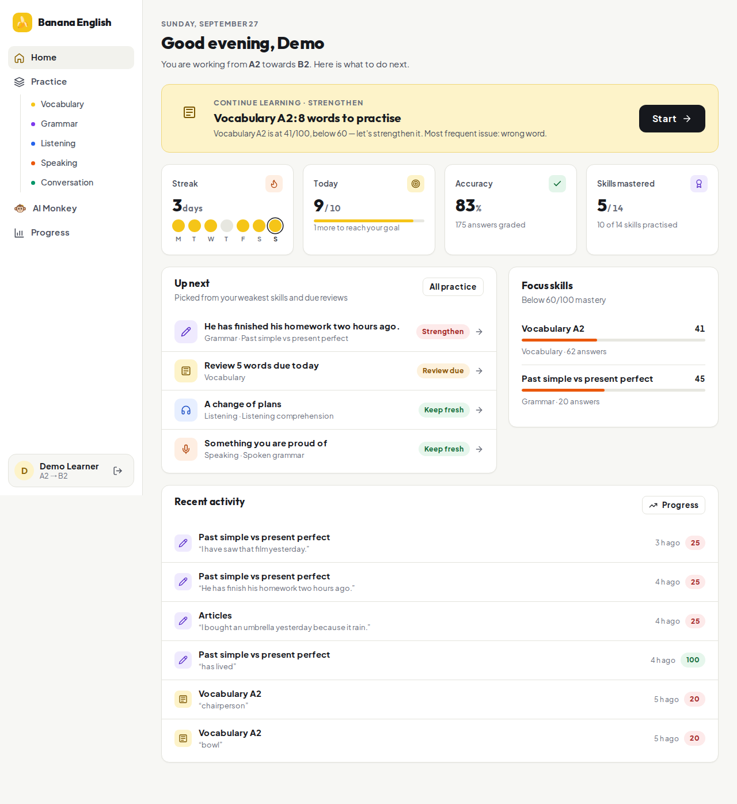
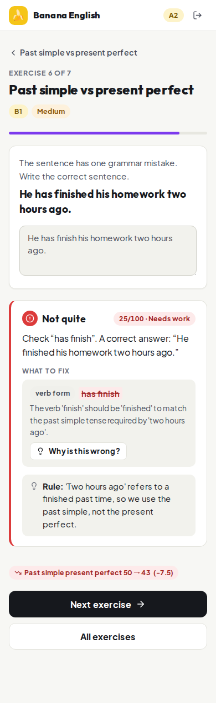
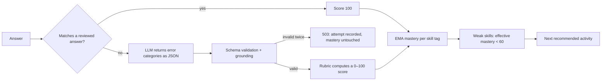

<div align="center">

# 🍌 Banana English

**An adaptive English learning platform that finds each learner's weak skills and keeps
steering practice back to them until they improve.**


[Features](#features) ·
[Quick start](#quick-start) ·
[How it works](#how-it-works) ·
[Architecture](#architecture) ·
[API](#api) ·
[Testing](#testing-and-quality) ·
[Status](#project-status)



</div>

## Why Banana English?

Most learning apps give you one overall level. That hides the real picture: a learner can be
at 90/100 on articles and 30/100 on the past tense at the same time.

Banana English tracks **mastery per skill tag**: every grammar topic, every vocabulary level,
listening, speaking and conversation. Every answer is assessed, the assessment updates mastery,
and mastery decides what the learner sees next:

```
Learn → Assess (one 0–100 rubric) → Update mastery (EMA per skill) → Recommend → Learn again
```

A learner who keeps getting the past tense wrong automatically gets more past-tense practice.
Nobody has to pick that topic by hand.

## Features

| Module | What the learner does | How it is assessed |
|---|---|---|
| **Vocabulary** | Reviews 7,351 CEFR-levelled words (A1–B2) with Again / Hard / Good / Easy buttons | SM-2 spaced repetition, as in Anki. Typed answers are checked deterministically, with typo tolerance |
| **Grammar** | Answers 42 exercises across 6 topics, at three difficulty levels | Reviewed answers match instantly. Anything else is graded by an LLM against the shared rubric |
| **Listening** | Listens to 8 short recordings and answers comprehension questions | The LLM judges the answer against the transcript, so paraphrases count |
| **Question bank** | Practises from a pool of about 100,000 grammar, vocabulary, reading and listening questions (A1–C1) built from open corpora. Sets are filtered by level, topic, grammar point and question type, and a new set is drawn on every request: unseen questions first, plus due reviews of wrong answers and weak skills | Checked by rules in the same request (option, accepted text, word accuracy, order, pairs). No LLM on the answer path. Instant feedback with the correct answer and an English + Vietnamese explanation. See [docs/question-bank.md](docs/question-bank.md) |
| **Speaking** | Records a spoken answer in the browser | Whisper transcribes it. Grammar and fluency are scored from the transcript, which is always shown |
| **Conversation** | Role-plays 4 scenarios, such as ordering at a café or asking for directions | The partner stays in character. Every turn is graded after the conversation ends |
| **AI Monkey** | Chats freely with an anime monkey from the "AI Monkey" tab: by typing, or hands-free in **Talk** mode (speak, pause, and the monkey answers aloud, with no Send button). A bilingual tutor: type in Vietnamese or English, pick a teaching mode (Auto, English Immersion, Vietnamese Support, Bilingual, Free Chat) or just say "từ giờ giải thích bằng tiếng Việt", "English only", "đừng sửa lỗi nữa" | Not graded. The monkey keeps the talk going and adds at most one friendly grammar tip, in English or Vietnamese. Vietnamese is shown as text (the voice speaks English) |
| **AI Tutor** | Clicks "why?" on any recorded error | A short explanation grounded in the teacher-written rule, plus a new example |
| **Home** | Sees the one thing to do next, a streak, a daily goal, focus skills and recent answers | "Continue learning" and "Up next" come straight from the recommender, so home and the app never disagree |
| **Progress** | Sees mastery per module and per skill, mastery curves over 7–90 days and daily activity | Built from the same per-skill mastery history the recommender uses |

<details>
<summary>Also included</summary>

- Accounts with scrypt password hashes, revocable 30-day sessions, an httpOnly cookie, and a
  login rate limit.
- Roles checked by the API on every request: students learn; teachers follow the students an
  admin assigns them and review question-bank items; admins manage users (role, disable /
  enable, never delete) and see platform statistics. See
  [docs/access-control.md](docs/access-control.md).
- Versioned prompts. Every attempt stores the prompt version and model that graded it.
- Prometheus metrics for LLM and speech-to-text latency, tokens and cost, and an audit log
  (`llm_calls`) keyed by request id.
- A calibration set and a CI gate that fails when a prompt change moves scores.
- A content review workflow: AI-drafted content stays `pending_review` until a teacher approves
  it.
- A mobile-first UI with light and dark themes: a sidebar on desktop, a bottom tab bar on phones,
  keyboard shortcuts for reviews, and no serious or critical axe (WCAG 2 AA) violations.

</details>

<p align="center">
  
</p>

## Quick start

### Prerequisites

- Docker with Docker Compose.
- [Ollama](https://ollama.com) on the host. The production model is **Qwen3-8B Q6_K**
  (`banana/qwen3-8b:q6_K`, about 8.2 GB of RAM when loaded). If you don't have Ollama, see
  [Without Ollama on the host](#without-ollama-on-the-host).

### Run the full stack

```bash
scripts/setup_ollama_model.sh      # once: ollama pull qwen3:30b-a3b-q4_K_M (Qwen3-30B-A3B, 18.6 GB)
cp -n .env.example .env            # model, context, timeout, thinking… (see Configuration)
docker compose up -d --build
```

The production LLM is **Qwen3-30B-A3B** (a mixture-of-experts model, about 3B parameters active
per token) from the Ollama library tag `qwen3:30b-a3b-q4_K_M`. Tasks that need reasoning (grammar error
analysis, the AI Tutor, AI Monkey explanations) use its thinking mode, the rest answer in
non-thinking mode, and the reasoning is never shown. The API loads the model when it starts
(`llm_ready model=…` in `docker compose logs api`), and Ollama keeps it loaded for
`LLM_KEEP_ALIVE`. Details, memory needs and troubleshooting: [docs/QWEN3_30B.md](docs/QWEN3_30B.md).

| Service | URL |
|---|---|
| Web app | http://localhost:3010 |
| API docs (Swagger) | http://localhost:8010/docs |
| Prometheus metrics | http://localhost:8010/metrics |

The first start downloads the Whisper model. Database migrations run automatically.

### Load a demo learner (optional)

```bash
docker compose exec api python scripts/simulate_learner.py --days 14
```

Sign in with **demo@banana.local** / **banana-demo** to see 14 simulated days of practice on the
dashboard.

### Share a public HTTPS link

A Cloudflare quick tunnel exposes **only the web app**. The API, `/docs` and `/metrics` stay on
localhost, and session cookies are marked `Secure`:

```bash
cp -n .env.example .env && sed -i 's/^COOKIE_SECURE=.*/COOKIE_SECURE=true/' .env
docker compose --profile public up -d --build
docker compose logs tunnel | grep -o 'https://[a-z0-9-]*\.trycloudflare\.com'
```

> [!NOTE]
> - The link works only while this machine is on.
> - The link changes whenever the `tunnel` container restarts. For a fixed hostname, use a
>   named Cloudflare tunnel (`tunnel run --token …`).
> - Anyone with the link can register, and every graded answer runs on your LLM.

### Fixed public link (Tailscale Funnel)

The quick tunnel above gets a new URL on every restart. For a link that never changes
(`https://banana-english.<your-tailnet>.ts.net`, the web app only):

1. Create a Tailscale auth key (admin console → Settings → Keys) and put it in `.env` as
   `TS_AUTHKEY=tskey-auth-…`; it is only used once, to register the machine.
2. In the admin console: DNS → enable HTTPS, and allow Funnel in the access policy
   (`"nodeAttrs": [{"target": ["autogroup:member"], "attr": ["funnel"]}]`).
3. `docker compose --profile funnel up -d` (restarts with Docker, keeping the same link).

### Android app (APK)

`frontend/` is also a Capacitor Android app (`com.bananaenglish.app`). The app opens the running
Banana English server in a WebView, so every feature works as on the web (sign-in, AI Monkey,
the microphone after Android asks for permission, voice). Its first screen (`frontend/mobile/`)
connects to the server URL given at build time and lets the learner enter a new one: a quick
tunnel gets a new URL each time the `tunnel` container restarts.

```bash
cd frontend
BANANA_APP_URL=https://banana-english.<tailnet>.ts.net npm run android:build   # fixed link
npm run android:build        # or: the URL of the running quick tunnel
# -> frontend/android/app/build/outputs/apk/debug/app-debug.apk
adb install -r android/app/build/outputs/apk/debug/app-debug.apk   # or copy it to the phone
```

It needs JDK 21 (`JAVA_HOME`, or `~/.local/jdk-21*`) and the Android SDK with platform 36
(`ANDROID_HOME`, or `~/Android/Sdk`). `npm run android:sync` updates the Android project and
`npm run android:open` opens it in Android Studio.

### Without Ollama on the host

```bash
docker compose --profile ollama up -d --build
scripts/setup_ollama_model.sh --docker
```

Then set `OLLAMA_URL=http://ollama:11434`.

### Local development

The backend runs without any model: mock LLM and speech-to-text providers are the default.

```bash
uv sync --all-groups
uv run pytest                                          # 300 tests, no network needed
uv run uvicorn banana_english.main:app --port 8010     # mock LLM
BANANA_LLM_PROVIDER=ollama BANANA_OLLAMA_MODEL=banana/qwen3-8b:q6_K \
  uv run uvicorn banana_english.main:app --port 8010   # real grading

cd frontend && npm install && npm run dev              # http://localhost:3000, proxies /api to :8010
```

## How it works



**One rubric for every module.**
- The bands are 90+ excellent, 70–89 good, 40–69 minor error and 0–39 major error.
  `is_correct` means a score of 70 or more.
- The LLM is never asked for a number. It returns error categories, each quoting a fragment
  that must appear in the answer. The platform then computes the score. This removed the +20
  bias that direct scoring had. The full story is in
  [docs/calibration](docs/calibration/README.md).

**Mastery.**
- Mastery is an exponential moving average per skill: `m = 0.3 · score + 0.7 · m`, starting at
  50.
- Repeating an exercise you already solved counts for only a third (alpha 0.1), so drilling
  one item cannot inflate mastery.
- Skills not practised for 7 days slowly decay back towards 50, with a 30-day half-life.

**Recommendation.** A deterministic rule engine behind a `RecommendationEngine` interface
builds the list in this order:
1. Up to three weak skills, weakest first. Material is easy when mastery is below 40,
   otherwise medium.
2. SM-2 vocabulary cards that are due.
3. New topics at or below the learner's level.
4. "Keep fresh" practice on the least recently practised skills.

A new learner therefore never sees an empty list.

**Slow model calls never block the UI.**
- Grammar and listening grading run as background jobs when the client sends
  `Prefer: respond-async`, which the web app always does.
- Speaking and the conversation summary are always background jobs.
- Resubmitting the same answer while it is being graded returns the same job, so it is counted
  once.

## Architecture

```
api ──► application ──► domain ◄── infrastructure
                          ▲
                config/container.py (the only place that knows concrete classes)
```

- **domain/**: pure Python.
  - Entities, the rubric, EMA mastery, SM-2 and weakness detection.
  - Ports: `LLMProvider`, `STTProvider`, `AssessmentEngine`, `RecommendationEngine`, `Cache`,
    `JobRunner` and repositories.
- **application/**: use cases, the grading engines, versioned prompts, strict LLM output
  contracts, the recommender and the tutor.
- **infrastructure/**:
  - Model providers: Ollama, faster-whisper, and mocks.
  - Storage and caching: SQLAlchemy with Alembic, Redis, a thread-pool job runner.
  - Observability: Prometheus metrics, request-id context.
- **api/**: FastAPI routers. The Pydantic schemas are the contract, exported to
  [docs/openapi.json](docs/openapi.json).

To swap Ollama for a hosted model, Whisper for another speech-to-text service, or the rule
engine for an ML ranker, you change one class and the composition root.

| Layer | Technology |
|---|---|
| Backend | Python 3.12, FastAPI, Pydantic v2, SQLAlchemy 2, Alembic, uv |
| AI | Ollama `qwen3:30b-a3b-q4_K_M` (Qwen3-30B-A3B; JSON-schema output, thinking per task; any Ollama model via `OLLAMA_MODEL`), faster-whisper `base.en`, Piper TTS |
| Data | PostgreSQL 16 (SQLite in tests), Redis 7 (verdict cache) |
| Frontend | Next.js 15, React 19, TypeScript, hand-written SVG charts |
| Ops | Docker Compose, GitHub Actions, Prometheus metrics, JSON logs, Cloudflare Tunnel |

## API

All endpoints live under `/api/v1`, and errors share one envelope:
`{"error": {"code", "message", "details"}}`. Sign in, then grade an answer:

```bash
TOKEN=$(curl -s localhost:8010/api/v1/auth/login -H 'Content-Type: application/json' \
  -d '{"email":"demo@banana.local","password":"banana-demo"}' | jq -r .token)

curl -s localhost:8010/api/v1/grammar/attempt -H "Authorization: Bearer $TOKEN" \
  -H 'Content-Type: application/json' \
  -d '{"exercise_id":"gr.past.004","answer":"I have saw that film yesterday."}' | jq .assessment
```

```json
{
  "score": 25.0, "is_correct": false, "band": "major_error",
  "feedback": "Check “have saw”. A correct answer: “I saw that film yesterday.”",
  "mistakes": [{"category": "verb_form", "fragment": "have saw", "correction": null, "explanation": "…"}],
  "assessor": "llm", "prompt_version": "grammar_assessment_v6", "model": "qwen3:30b-a3b-q4_K_M"
}
```

| Area | Endpoints |
|---|---|
| Auth | `POST /auth/register`, `/auth/login`, `/auth/logout`, `GET /auth/me` |
| Learner | `GET /learner/profile`, `/mastery`, `/weak-skills`, `/mastery-history`, `/activity`, `/attempts` |
| Practice | `/vocabulary/*`, `/grammar/*`, `/listening/*`, `/speaking/*`, `/conversations/*`, `POST /tutor/explain` |
| Question bank | `GET /bank/{skill}/facets`, `POST /bank/{skill}/sets`, `POST /bank/answer`, `GET /bank/passages/{id}/transcript`, `GET /bank/{skill}/summary` |
| Adaptivity | `GET /recommendation/next` |
| Teachers | `GET /teacher/students`, `/teacher/students/{id}/progress`, `/teacher/students/{id}/attempts` (assigned students only) |
| Admin | `GET /admin/users`, `GET`/`PATCH /admin/users/{id}`, `PUT`/`DELETE /admin/users/{teacher}/students/{student}`, `GET /admin/stats` |
| AI Monkey | `POST /monkey/chat`, `POST /monkey/transcribe`, `POST /monkey/speech`, `GET /features` |
| Jobs & ops | `GET /jobs/{id}`, `/health`, `/api/v1/health`, `/metrics` |

The full reference is in [docs/api-contract.md](docs/api-contract.md), and interactive docs are
at `/docs`.

## Configuration

Settings are environment variables with the `BANANA_` prefix. With Docker Compose, put them in
`.env` without the prefix (for example `OLLAMA_MODEL`, `LLM_TIMEOUT_SECONDS`): see
[.env.example](.env.example).

| Variable | Default | Purpose |
|---|---|---|
| `BANANA_DATABASE_URL` | `sqlite:///banana_english.db` | Compose uses PostgreSQL |
| `BANANA_REDIS_URL` | unset | Verdict cache. Falls back to in-process memory |
| `BANANA_LLM_PROVIDER` | `mock` | `mock` or `ollama` (Compose uses `ollama`) |
| `BANANA_OLLAMA_URL` | `http://127.0.0.1:11434` | Compose: the host's Ollama |
| `BANANA_OLLAMA_MODEL` | unset (required with `ollama`) | Compose and `.env.example`: `qwen3:30b-a3b-q4_K_M` (Qwen3-30B-A3B) |
| `BANANA_LLM_CONTEXT_LENGTH` | `8192` | `num_ctx` sent with every request (fits the longest chat history) |
| `BANANA_LLM_TIMEOUT_SECONDS` | `180` | Per reply. The web proxy waits this + 30 s (build arg `LLM_TIMEOUT_SECONDS`) |
| `BANANA_LLM_MAX_RETRIES` | `1` | Retries after an error or invalid output, never after a timeout |
| `BANANA_LLM_TEMPERATURE` / `BANANA_LLM_MAX_OUTPUT_TOKENS` | unset | Unset: each task's tuned value. Set: temperature for every task / a cap on every reply |
| `BANANA_LLM_KEEP_ALIVE` / `BANANA_LLM_WARM_UP` | `30m` / `true` | How long Ollama keeps the model loaded; load it when the API starts |
| `BANANA_LLM_THINKING` / `BANANA_LLM_THINK_BUDGET` | `true` / `1024` | Qwen3 thinking for the tasks that reason (grammar analysis, tutor, AI Monkey explanations); reasoning tokens allowed on top of the answer. The reasoning is never returned |
| `BANANA_LLM_FALLBACK_MODEL` | unset | A second model used only when the primary is unavailable (not on timeouts). Every use is logged (`llm_fallback`) and never cached |
| `BANANA_LLM_COST_PER_1K_TOKENS` | `0` | Set this for hosted APIs to get cost metrics |
| `BANANA_STT_PROVIDER` / `BANANA_WHISPER_MODEL` | `mock` / `base.en` | `whisper` in Compose |
| `BANANA_REQUIRE_REVIEWED_CONTENT` | `false` | Serve only teacher-approved content |
| `BANANA_COOKIE_SECURE` | `false` | Set `true` behind HTTPS. Compose reads `COOKIE_SECURE` from `.env` |
| `BANANA_SESSION_DAYS` | `30` | Session lifetime |
| `BANANA_DAILY_NEW_CARDS` | `10` | New vocabulary cards per day |
| `BANANA_JOB_WORKERS` | `2` | Background grading threads |
| `BANANA_MAX_UPLOAD_MB` | `10` | Maximum speaking upload size |
| `BANANA_TTS_PROVIDER` / `BANANA_TTS_VOICE` | `mock` / `en_US-ljspeech-medium` | AI Monkey's voice: `piper` in Compose, downloaded once into `BANANA_TTS_MODEL_DIR` |
| `BANANA_FEATURE_AI_MONKEY` | `true` | Show the AI Monkey tab. Off: its endpoints return 404 and the tab is hidden |
| `BANANA_LOG_JSON` | `false` | JSON logs (on in Compose) |

## Project structure

```
├── src/banana_english/
│   ├── domain/            # entities, ports, rubric, mastery, SM-2 (no framework imports)
│   ├── application/       # use cases, grading engines, prompts, recommender, tutor
│   ├── infrastructure/    # Ollama, Whisper, SQLAlchemy + Alembic, Redis, jobs, metrics
│   ├── api/               # FastAPI routes, schemas (the contract), mappers
│   ├── contentbank/       # question-bank pipeline: sources, generators, audit, import
│   └── config/            # settings + composition root
├── frontend/              # Next.js app
│   ├── app/               # routes: home, practice hub + 5 modules, AI Monkey, progress
│   ├── components/ui/     # design system: PageHeader, Panel, Stat, Callout, Segmented, Tag, …
│   ├── components/        # app shell, learner/AI Monkey providers, feedback, charts
│   └── lib/               # API client, module registry, Talk mode (VAD, TTS, session)
├── content/               # vocabulary, grammar, listening (+ audio), speaking, scenarios, calibration
│   └── bank/              # question bank: JSONL.gz shards + manifest (audio mounted, not in the image)
├── scripts/               # content build, calibration, simulation, smoke test, review tool
├── tests/                 # unit + integration (mocks only)
└── docs/                  # architecture, API contract, phases, calibration, decisions
```

| Script | Purpose |
|---|---|
| `scripts/review_content.py` | Teacher review of AI-drafted content: approve, reject or edit answers |
| `scripts/calibrate.py` | Grade the calibration set with the real model and write the report |
| `scripts/tutor_check.py` | Write tutor explanations of real errors to a file for teacher review |
| `scripts/simulate_learner.py` | Simulate practice days to produce mastery curves |
| `scripts/smoke_live.py` | Run every module end to end against a running stack |
| `scripts/build_vocabulary.py`, `scripts/build_listening_audio.py` | Rebuild content from its sources |
| `scripts/export_openapi.py` | Regenerate `docs/openapi.json` |
| `python -m banana_english.contentbank fetch\|build\|audio\|import\|audit` | The question-bank pipeline ([docs/question-bank.md](docs/question-bank.md)) |
| `python -m banana_english.manage set-role\|set-active\|list` | Accounts on the server: make the first admin, disable an account ([docs/access-control.md](docs/access-control.md)) |
| `scripts/audit_content.py` | Question-bank audit: counts, duplicate and invalid rates, broken links, missing audio |
| `scripts/bench_bank.py` | Question-bank latency (set generation, answer checking) against a running stack |

## Documentation

| Document | Contents |
|---|---|
| [docs/architecture.md](docs/architecture.md) | Layers, the core loop, data model, async work, auth, observability |
| [docs/api-contract.md](docs/api-contract.md) · [docs/openapi.json](docs/openapi.json) | The HTTP contract |
| [docs/access-control.md](docs/access-control.md) | Roles (admin, teacher, student), the endpoint map, ownership rules, making the first admin |
| [docs/question-bank.md](docs/question-bank.md) | The question bank: pipeline, one-right-answer rules, statuses, set building, answer checking |
| [docs/phases.md](docs/phases.md) | Definition of Done for every phase, with evidence and measured numbers |
| [docs/calibration/README.md](docs/calibration/README.md) | How grammar grading went from a +20 bias to +4.7, and the AI Tutor check |
| [docs/decisions/](docs/decisions/) | Architecture decision records |

## Testing and quality

```bash
uv run pytest                     # 300 tests: unit + integration, mock providers, about 25 s
uv run ruff check . && uv run ruff format --check .
cd frontend && npx tsc --noEmit && npm test && npm run build   # 95 frontend tests
python3 scripts/smoke_live.py     # live: real LLM + Whisper against the running stack
```

The tests cover:
- the EMA properties, and SM-2 over a simulated 90 days;
- the rubric, and 11 kinds of malformed or ungrounded LLM output;
- retries, and the rule that a failed grading never changes mastery;
- every phase's learning loop over HTTP, including "fail the past tense → the past tense is
  recommended next";
- async grading and duplicate submissions;
- AI Monkey chat, voice transcription, the feature flag, and that free chat never changes mastery;
- the question bank: every answer type checked by rules, sets without answers, no repeats
  across sets, due reviews and weak skills first, filters, approved-only mode, idempotent
  import; and each one-right-answer rule of the generators (the generator tests need
  `uv sync --group content` and are skipped without it);
- access control: every role against every staff endpoint, a student reaching another
  student's data, a teacher reaching a student not assigned to them, a forged role at sign-up,
  self-promotion, a disabled account with a live session, expired and forged tokens;
- auth, the migrations matching the models, and an OpenAPI snapshot.

CI ([.github/workflows/ci.yml](.github/workflows/ci.yml)) runs lint, the tests, the calibration
regression gate, a frontend type-check and build, and both Docker images.

### Model benchmark

`banana_english.benchmark` compares Ollama models on the app's own prompts (grammar grading,
tutor, role-play, AI Monkey) plus vocabulary and complex-question prompts: 48 tests in 6
categories, the same parameters for every model, a warm-up and a model reload before each of ≥3
runs, and a deterministic 7-dimension rubric. By default it compares Qwen3-8B Q4_K_M, Q5_K_M,
Q6_K and Q8_0. It never changes the production model.

```bash
docker compose --profile benchmark run --rm benchmark                      # quick: 6 tests × 3 runs
docker compose --profile benchmark run --rm benchmark --suite full --pull  # full: 48 tests × 3 runs
uv run python -m banana_english.benchmark --help                           # same CLI without Docker
```

Results go to `benchmarks/results/<suite>/`: `results.json`, `results.csv`, `generations.csv`
and `report.md` (score = 90% quality + 10% performance). Latest run (quick suite):
[benchmarks/results/quick/report.md](benchmarks/results/quick/report.md). Q6_K scored best
(quality 100, overall 97.9) and is the production model; the benchmark runs independently of it
(its own `bench/*` aliases), but it unloads every model while it runs.

## Measured results

Measured with Qwen3-30B-A3B (`qwen3:30b-a3b-q4_K_M`) on a laptop: Ryzen 5 7535HS (6 cores,
12 threads), 14 GB RAM, Radeon RX 6500M with 4 GB (Vulkan; about 3 GB of the model on the GPU,
the rest read through the page cache).

| What | Result |
|---|---|
| Grammar grading, calibration set (prompt v6, thinking) | MAE 8.15, bias +1.15, 20/20 correct/incorrect agreement, **against AI-drafted labels not yet verified by a teacher**. Qwen3-8B Q6_K: MAE 15.7, bias +4.7, 16/20; prompt v2 had a +20.2 bias |
| Grammar grading latency (background job, thinking) | 36–70 s. Exact matches and cache hits return instantly |
| AI Tutor "why?" (thinking) | about 45 s |
| AI Monkey | small talk about 13 s; an explanation (thinking) 22–37 s |
| Speaking, end to end | about 44 s (Whisper + grammar grading with thinking) |
| Conversation reply | 4–11 s; the end-of-conversation grading (each turn, thinking) about 3.5 min in the background |
| Model speed | prompt about 80 tokens/s, replies 10–14 tokens/s; first load about 22 s |
| Whisper on the listening audio | 7.2% word error rate |
| Question bank, 103,390 questions on PostgreSQL | New set p50 14–16 ms, p95 under 50 ms; answer checked and recorded p50 9–10 ms, p95 under 12 ms; no LLM on the answer path |
| 14-day simulated learner | Past tense started at 20% ability, became the most recommended skill, and finished at a mastery of 79.9 |

More numbers and the reasoning behind each parameter are in [docs/phases.md](docs/phases.md).

## Project status

All 12 phases, from scope and architecture to deployment, are built and run end to end. What
is left needs a person or is a known limitation:

- [ ] **Teacher review of AI-drafted content.** This covers 42 grammar exercises, 8 listening
  lessons, 6 speaking prompts and 4 scenarios. Run `scripts/review_content.py`, then set
  `BANANA_REQUIRE_REVIEWED_CONTENT=true`.
- [ ] **Teacher verification** of the 20 calibration labels and
  [the tutor check](docs/calibration/tutor_check.md). Until then, the calibration numbers mean
  "agrees with the rubric draft", not "agrees with a teacher".
- [ ] A listening calibration set.
- [ ] Example sentences for the 47% of vocabulary items that have none.
- [ ] **Talk mode.** There is no barge-in yet: you cannot interrupt the monkey while it speaks.
  On iOS Safari, Talk falls back to the tap-to-record microphone.
- [ ] **Pronunciation.** Phoneme-level scoring is deliberately out of scope. Speaking is graded
  on grammar and fluency from the transcript.

**Scope.** The job runner, the duplicate-submission guard and the login rate limit are
in-process. They are designed for one host running one API process. A Redis-backed queue would
slot in behind `JobRunner`.

## Contributing

1. Keep the dependency rule: `domain/` imports no framework, and only `config/container.py`
   knows concrete classes.
2. If you change a prompt, bump its version in `application/services/prompts.py`, run
   `scripts/calibrate.py`, and commit the report. CI fails otherwise.
3. If you change the API, run `scripts/export_openapi.py`.
4. If you change the database schema, add an Alembic revision:
   `uv run alembic revision --autogenerate -m "…"`.
5. Before opening a pull request, run `uv run pytest` and `uv run ruff check .`.

## Data attribution

- **CEFR-J Wordlist Version 1.5.** Compiled by Yukio Tono, Tokyo University of Foreign Studies.
  Retrieved from http://www.cefr-j.org/download.html via
  https://github.com/openlanguageprofiles/olp-en-cefrj. Free for research and commercial use
  with citation. © Tono Laboratory, TUFS.
- **Open English WordNet 2024** (https://github.com/globalwordnet/english-wordnet),
  [CC BY 4.0](https://creativecommons.org/licenses/by/4.0/). Changes: one sense per CEFR-J
  headword was selected automatically, and only its definition and one example are used.
- **Tatoeba** (https://tatoeba.org) sentences and their Vietnamese translations,
  [CC BY 2.0 FR](https://creativecommons.org/licenses/by/2.0/fr/). Used as the source
  sentences of grammar, vocabulary and listening questions; sentences were changed into
  questions (gaps, distractors, reordering).
- **Wikipedia** and **Simple English Wikipedia** (dump 2023-11-01 via
  `wikimedia/wikipedia` on Hugging Face), [CC BY-SA 4.0](https://creativecommons.org/licenses/by-sa/4.0/).
  Lead paragraphs are used as reading and listening passages; the questions made from them
  are shared under the same license. The article title is kept in each passage's `source.ref`.
- **Wiktionary** (Vietnamese and English editions, extracted by
  [kaikki.org](https://kaikki.org)), CC BY-SA 4.0. Vietnamese meanings of English words.
- **wordfreq** (Robyn Speer, CC BY-SA 4.0 data) for word frequencies, and **lemminflect**
  (MIT) for word forms; used only in the offline build.
- **Listening audio** was synthesised with Piper TTS using the `en_US-ljspeech-medium` voice,
  which is trained on the public-domain LJ Speech dataset. Piper runs only in the offline build
  script.

## License

No license has been chosen for the code yet, so all rights are reserved by default. Add a
`LICENSE` file before accepting outside contributions. The third-party data above keeps its own
licence.
